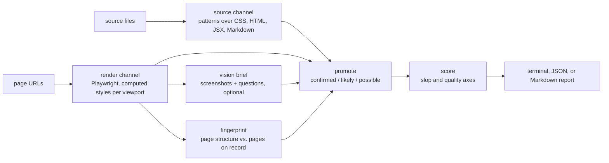

# redpen

A linter for the tells that make a UI, its code and its docs read as machine-made.

[](LICENSE)

[](https://github.com/gshepptech/redpen/actions/workflows/ci.yml)


Generated interfaces share a look: the default violet, a centred hero over three
cards, gradient headings, emoji in rounded squares, copy that would fit any
product. Generated code and docs have their own tells. redpen finds them, along
with the ordinary defects that are broken whatever the taste, such as low
contrast, unlabelled inputs and missing focus styles.

It reads your source, renders the page in a real browser, and reports a finding
as confirmed only when the evidence agrees. A source-only match that the render
pass checked and could not reproduce is demoted rather than counted. Each
finding comes with its weight, the channels that saw it, the file and line, and
a fix.

## Features

- 184 rules in 16 categories, merged from five public catalogues of AI design
  and writing tells, with each rule's provenance kept (`redpen why <id>`).
- Cross-checked evidence: source patterns, computed styles in Chromium via
  Playwright, and an optional screenshot review are reconciled into
  `confirmed`, `likely` and `possible`.
- Two scores: `slop` (reads as machine-made) and `quality` (broken regardless
  of taste) are kept separate, so you can see which one is the problem.
- Surface detection: it works out whether a page is marketing, app UI or docs,
  and turns off rules that do not hold there. A single type family is fine on a
  dashboard and a tell on a landing page.
- Sameness across pages: it records a structural fingerprint for every page
  and reports pages that are the same layout with a different palette.
- Code and docs mode: `redpen code` checks source and Markdown for stubs,
  swallowed errors, edit-history comments, agent bylines and generated prose.
  It also runs jscpd, madge and knip when the project already has them.
- A CI gate that ratchets: `redpen check` fails when the score drops below a
  recorded baseline or a new tell appears. It does not demand a perfect score.

## Quick start

redpen needs Node 20.11 or later. The package is not on npm yet, so install it
from GitHub. The tracked `bundle/redpen.mjs` has its dependencies inlined, so no
build step runs on install.

```bash
npm i -g github:gshepptech/redpen
npm i -g playwright && npx playwright install chromium   # optional: the browser pass
redpen --help
```

To try it on the sample page in this repository:

```bash
git clone https://github.com/gshepptech/redpen && cd redpen
python3 -m http.server 8765 -d examples/landing &
redpen scan examples/landing http://localhost:8765 --viewport 1440
```

Output, trimmed:

```
  … render: 29 rule(s) hit
  … surface: http://localhost:8765 is "persuade" (0.88) — full-height opener, pricing or signup language

  redpen   11/100  slop

  slop      11  ██░░░░░░░░░░░░  19 findings — reads as machine-made
  quality   22  ███░░░░░░░░░░░  13 findings — broken regardless of taste

  CONFIRMED (28)

  ● Gradient-filled heading text [source+render] gradient-text · 91
    Gradient-filled type is the single most-cited visual giveaway after colour
    choice. It also degrades legibility, because the contrast ratio varies
    across the word.
    fix Solid colour on every heading. If the hero needs more presence, get it
        from scale, weight, or a drawn rule under the line — not from the fill.
      style.css:32  -webkit-background-clip: text;
      style.css:33  background-clip: text;
      localhost:8765 section.hero > h1.hero__title @1440px  Supercharge your te…

  ● Text below its contrast threshold [render] low-contrast · 86
      localhost:8765 section.hero > p.hero__lede @1440px  2.85:1 needs 4.5:1 — …
```

Without a URL, or without Playwright, redpen runs source-only and says so. Every
finding the browser could have confirmed stays at `possible`, and the report
lists the channels that did not run. A missing channel is never reported as a
clean page.

### As a Claude Code plugin

```
/plugin marketplace add gshepptech/redpen
/plugin install redpen
```

This adds `/redpen:audit`, `/redpen:code`, `/redpen:gate`, `/redpen:why`, five
scoped fix commands (`typeset`, `layout`, `color`, `polish`, `distill`), and a
skill that runs when you build or review UI.

## How it works



Rules live in `rules/*.yaml`. Each one declares its category, weight, the
channels that can see it, the surfaces it applies to, and its upstream sources.

| Channel | Sees | Blind to |
| --- | --- | --- |
| source | literal patterns, class names, imports | anything computed or themed at runtime |
| render | computed styles and geometry in Chromium, per viewport | routes you did not list, states you did not drive |
| vision | a screenshot judged by whoever runs redpen | anything outside the frame |
| fingerprint | this page against every other page on record | a project with one page |
| tools | jscpd, madge and knip output, when installed | everything, if none are installed |

A finding is `confirmed` when two channels saw it independently, or when the
only channel able to see it did. The vision channel takes no API key: `--vision`
writes screenshots and a question brief, and `--answers` folds the replies back
in. A vision answer never confirms a finding on its own.

Pass a bare origin and redpen reads the app's routes from the repository (Next,
SvelteKit, Astro, Nuxt, React Router, Vue Router) instead of scanning only the
home page. `redpen login <url>` opens a browser, lets you sign in however the
app works, and saves the session for later scans. A page that redirects
somewhere you did not ask for is refused and named, so a login screen is never
scored as your dashboard.

## Usage

```
redpen scan [path] [url...]  run every available channel and print the report
redpen code [path]           check the source and docs instead of the page
redpen check [path]          exit non-zero when the score drops below baseline
redpen baseline [path]       record the current score as the bar to hold
redpen why <rule-id>         explain one rule and where it came from
redpen why-score [path]      what the score is made of and what would move it
redpen rules                 list the corpus
redpen login <url>           sign in in a real browser and save the session
redpen init [path]           write .redpen/config.json
```

Common options: `--url <u>` (repeatable), `--viewport <n>` (default 375, 768,
1440), `--json [file]`, `--markdown [file]`, `--only <categories>`,
`--min <confidence>`, `--vision`, `--answers <file>`, `--verbose`. Run
`redpen --help` for the full list.

### Configuration

`.redpen/config.json`:

```json
{
  "urls": ["http://localhost:3000", "http://localhost:3000/pricing"],
  "surface": "operate",
  "surfaceByUrl": { "http://localhost:3000/": "persuade" },
  "viewports": [375, 768, 1440],
  "minConfidence": "likely",
  "capabilities": { "javascript": false },
  "tolerance": 0,
  "ignore": { "ai-purple": "the brand is violet, signed off by design" }
}
```

`capabilities` turns off rules whose fix the project cannot use. For example, a
server-rendered app with no client JavaScript will not be told to add inline
validation.

### Suppressing a finding

```css
/* redpen-ignore:ai-purple the brand is violet, signed off 2026-03 */
--primary: #7c3aed;
```

The reason is required. An ignore with no reason does nothing, and
`redpen scan --show-ignored` lists everything a project has excused.

### In CI

Add redpen as a dev dependency (`npm i -D github:gshepptech/redpen`) so `npx`
resolves the local binary. The bare `redpen` name on npm is an unrelated
package.

```yaml
- run: npx redpen baseline . --url http://localhost:4173   # once, then commit .redpen/
- run: npx redpen check . --url http://localhost:4173
```

`check` fails when the score falls by more than `tolerance`, or when a rule
fires that was not present at baseline.

## Scope and limits

The corpus is 184 rules across 16 categories, and the suite is 284 tests.

The upstream catalogues use different vocabularies and overlap heavily, so
running them side by side doubles the false positives.
redpen merges them into 184 rules and records which catalogue named each one. Some tells, such as the em dash,
are common in human writing too, so they are advisory: reported, never scored.
12 rules are marked this way. Rules that only hold on one kind of page carry a
surface list, and 38 rules are scoped accordingly.

```
  184 rules merged from:
     225  catalogue
      68  heuristics
      23  study
      23  redpen
```

The counts add up to more than the rule total because most rules were named by
more than one catalogue.

Known limits:

- The vision channel is answered by a person or an agent. redpen does not call a
  model itself.
- Dark mode gets one extra pass (the emulated preference, plus the page's own
  theme toggle if it has one), not a full matrix against every viewport.
- The eight composition rules ask a judgement question no detector can answer,
  and no study has measured them.
- Without jscpd, madge or knip installed, duplication, import cycles and unused
  exports are not checked. The report says so.

## Development

```bash
npm ci
npx playwright install chromium   # the end-to-end tests drive a real browser
npm run build                     # tsc to dist/, then esbuild to bundle/redpen.mjs
npm test                          # build, then node --test test/*.test.mjs
```

`bundle/redpen.mjs` is tracked so a plugin or git install works with no build
step. A test fails if it drifts from `src/`, so rebuild before committing.
`test/POLICY.md` explains the one rule the suite holds new rules to.

## License

MIT, see [LICENSE](LICENSE). Five files,
`commands/{typeset,layout,color,polish,distill}.md`, are derived from
Apache-2.0 material and stay under that license; see
[LICENSE-APACHE-2.0](LICENSE-APACHE-2.0) and [NOTICE](NOTICE), which also
credits the upstream catalogues.
